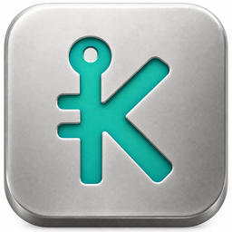

# Kaspa Cold / Kaspa 离线钱包生成器



A small native, offline-only Kaspa mnemonic and receiving-address generator.
一个轻量的原生离线工具：生成助记词、核对恢复地址、导出公开收款信息。

[Download test builds / 下载测试版](https://github.com/w00c00/kaspa-cold/releases) · [Validation / 验证记录](VALIDATION.md)

Available for macOS Apple Silicon / Intel, Windows x64 and Linux x64. Portable archives are approximately 4.6–6.3 MiB, including artwork and licenses. Version **0.1.0 is released**; it is not independently audited custody software.

支持 macOS Apple Silicon／Intel、Windows x64 和 Linux x64。含图标及许可证的便携包约 4.6–6.3 MiB。**0.1.0 已正式发布**，但不是经过独立审计的资产保管产品。

**Recommended Windows download / 推荐 Windows 下载：** [windows-portable-cpu1](https://github.com/w00c00/kaspa-cold/releases/download/v0.1.0/Kaspa-Cold-0.1.0-windows-portable-cpu1-x86_64-pc-windows-gnu.zip). It draws using the CPU and Windows GDI, with no OpenGL, Electron, WebView, Node.js or extra MinGW DLLs. Extract and run `kaspa-cold.exe`; the other files are documentation/licenses. Fully offline, with unchanged derivation and backup flow. **The user confirmed it runs on physical Windows 11 hardware on 2026-10-14**, resolving the reported OpenGL startup failure. This is not certification of every operation or Windows configuration. Original assets remain available. See [instructions / 操作说明](WINDOWS_DIAGNOSTICS.md).

Windows 请优先使用上面的 CPU 兼容版。解压即可运行，无需额外安装图形运行库；仍是完全离线程序，助记词和地址规则不变。**用户于 2026-10-14 确认 Windows 11 实体机可运行，原 OpenGL 启动问题已解决**；不代表所有功能或 Windows 配置均已验证。

Measured CPU build / CPU 版实测体积：EXE **4.74 MiB**; ZIP including documentation/licenses approximately **4.61 MiB**. No UPX or executable packing. / 未使用 UPX 或可执行文件加壳。

## 安全边界 / Security boundaries

这是测试版软件，不是硬件钱包，不是已独立审计的产品。请使用干净、长期离线的专用设备；普通电脑临时断网并不能消除恶意软件风险。正式存钱前先验证恢复，再做小额收款和支出测试（支出需另用支持的签名钱包）。

This is a test build, not a hardware wallet or an independently audited product. Use a clean, permanently offline device. Temporarily disconnecting a normal computer does not remove malware risks. Verify recovery first, then test small deposits and withdrawals using a compatible signing wallet.

- 无节点、AI、遥测、自动更新、余额查询、交易构建或签名。No node, AI, telemetry, updater, balance lookup, transaction building or signing.
- 钱包不保存。只有用户主动导出的公开地址 PNG 和恢复说明 TXT 会写入文件。Wallets are never persisted. Only explicitly exported public address PNGs and recovery-info TXTs are written.
- 英文 BIP39，12／24 词，默认 24 词；**不支持 BIP39 附加口令**。English BIP39, 12/24 words (24 by default); **no BIP39 passphrase**.
- 固定标准单签账户 0，收款路径 `m/44'/111111'/0'/0/i`，Schnorr P2PK。Standard single-signature account 0, receiving path `m/44'/111111'/0'/0/i`, Schnorr P2PK.
- 不支持旧版 KDX／非标准派生；相同助记词在其他派生路径下会产生不同地址。Legacy/nonstandard derivation is not supported; different paths produce different addresses.
- 主网默认使用 `kaspa:`；TN10 使用 `kaspatest:`。测试网前缀本身不能区分 TN10 与其他 Kaspa 测试网。Mainnet uses `kaspa:`; TN10 uses `kaspatest:`, a prefix also shared with other testnets.
- 系统安全随机源失败就停止，不回退弱随机数。OS CSPRNG failure stops generation; no weak fallback.
- 秘密不允许复制、导出或记日志。恢复允许粘贴，输入框遮蔽并清除撤销历史。Secrets cannot be copied/exported/logged. Recovery permits paste; input is masked and undo history is cleared.
- 备份确认后只保留公开派生状态。清除、关闭尽力清零敏感缓冲区；第三方密码学对象、界面渲染、分配器、交换内存和系统崩溃转储可能保留副本，不保证完整内存擦除。After backup confirmation, only public derivation state is retained. Sensitive buffers are zeroized on clearing/closing where feasible. Third-party crypto objects, rendering, allocator memory, swap and OS crash dumps may retain copies; complete memory erasure is not guaranteed.
- 窗口失焦隐藏秘密，不会阻止截屏或系统级窃取。Focus loss hides secrets; it cannot prevent screenshots or OS-level theft.

Never screenshot, cloud-sync, message, or network-print a mnemonic. Keep handwritten backups offline and separate from public recovery files. Importing a mnemonic into an online wallet ends its cold-storage isolation.

不要截图、上传云盘、发送聊天或联网打印助记词。手写备份离线保管，与公开恢复说明分开。将助记词导入联网钱包后，不再保持冷存储隔离。

## 使用 / Usage

1. Disconnect the clean device and start the app. / 在干净设备上断网后启动。
2. Create wallet → read warning → generate → write words in order → confirm three requested words. / 创建钱包 → 阅读提示 → 生成 → 按顺序手写 → 核对三个指定单词。
3. Copy only the public address, export its QR and recovery information. / 只复制公开地址，可导出地址二维码和恢复说明。
4. Clear the session, recover from the handwritten mnemonic, and compare address/network/path/index. / 清除会话，使用手写助记词恢复，核对地址、网络、路径和序号。

The app has no saved wallet/password/unlock state. Losing your mnemonic means losing recovery. Public recovery files alone cannot restore funds. / 没有已保存钱包、密码或解锁状态。丢失助记词就无法恢复；公开说明文件不能单独恢复资金。

## 固定版本构建 / Pinned build

Rust **1.95.0**; direct dependencies pinned in `Cargo.toml`, transitive versions in `Cargo.lock`. Kaspa key/address crates **2.1.0**, egui **0.33.3**. Windows: egui_software_backend **0.0.2**, softbuffer **0.4.8**, CPU rasterization + system GDI. macOS/Linux: eframe **0.33.3**, Glow. No Electron, WebView or Node.js runtime. Windows excludes eframe/Glow from its normal dependency graph and disables rasterized tile caching to avoid retaining secret text there.

```sh
cargo fetch --locked
cargo test --locked
cargo clippy --locked --all-targets -- -D warnings
cargo build --release --locked
```

Build dependencies are fetched online on the build machine, never on the cold device. After fetching, use `--offline --locked` for an offline build. Dependency archives/toolchain are required in cache. Build artifacts are not guaranteed bit-for-bit identical across differing OS/linker/SDK versions; record those versions when reproducing.

构建机器可以联网下载依赖，冷设备不需要网络。缓存齐备后可加 `--offline --locked` 离线构建；不同操作系统、链接器和 SDK 不保证逐字节相同。

- macOS: Xcode Command Line Tools; Apple Silicon and Intel built separately.
- Windows: Rust MSVC toolchain + Visual Studio C++ build tools; GNU cross-builds are also possible and explicitly marked.
- Linux: C compiler, pkg-config, X11/Wayland/OpenGL development support; on Ubuntu install `build-essential pkg-config libx11-dev libxi-dev libxcursor-dev libxrandr-dev libxinerama-dev libxkbcommon-dev libwayland-dev libegl1-mesa-dev`.

The portable Windows CPU build requires Windows 10/11 x64 and built-in system UCRT/GDI; no OpenGL driver or external MinGW DLLs are required. User-confirmed running on physical Windows 11; Windows 10 remains unverified. Older original/diag1 downloads still use OpenGL. Linux requires glibc **2.28+**, an X11/Wayland desktop and OpenGL; file exports require a working desktop portal. Linux real-device testing remains pending.

新版 Windows CPU 便携包只使用 Windows 10／11 x64 自带的 UCRT／GDI，不需要 OpenGL 驱动或额外 MinGW DLL。Windows 11 实机已由用户确认可运行，Windows 10 尚待验证。旧原版／diag1 仍依赖 OpenGL。Linux 需要 glibc **2.28+**、X11／Wayland 桌面、OpenGL，文件导出依赖桌面 portal；Linux 尚待实机验证。

Run `python3 scripts/package.py --target <triple>` after a release build. It makes portable packages, includes licenses and checksums, and never publishes anything. macOS archives are ad-hoc signed, **not Apple Developer signed/notarized**; Windows binaries are **unsigned**. Do not disable security protections globally to run test builds.

The approved K-key icon is embedded in the native window and app header. macOS bundles include ICNS; Windows executables include a multi-size ICO resource. Linux bundles include `kaspa-cold.png` and `org.kaspa.cold.desktop`. The Linux desktop file is optional: install the executable on your PATH, the PNG under `~/.local/share/icons/hicolor/512x512/apps/kaspa-cold.png`, and the desktop file under `~/.local/share/applications/` before using the launcher. Nothing is installed automatically.

已选定的 K 钥匙图标用于软件窗口、界面标题、Mac 应用和 Windows EXE。Linux 附带图标及可选 desktop 启动器，须按上述位置自行安装；不会自动修改系统。重新准备图标可运行 `python3 scripts/prepare_icons.py`（需要 Pillow，ICNS 生成需要 macOS iconutil）。Windows MSVC 构建需要 SDK 的 `rc`；GNU 构建需要 `windres`。交叉编译可设置 `KASPA_COLD_RC` 指向 LLVM 的 `llvm-rc`，或设置 `KASPA_COLD_ZIG` 指向 Zig 0.14.1（部分 macOS 环境需使用 LLVM 替代其资源编译器）。

发布包需人工验证 SHA256。macOS 测试包只有本地 ad-hoc 签名，没有 Apple 开发者签名／公证；Windows 没有发行者签名。不要全局关闭系统安全保护。

## 来源与许可证 / Sources & licenses

- [Kaspa wallet primitives](https://kaspa.aspectron.org/wallets/primitives/index.html)
- [Official rusty-kaspa](https://github.com/kaspanet/rusty-kaspa)
- [BIP39](https://github.com/bitcoin/bips/blob/master/bip-0039.mediawiki)
- [egui](https://github.com/emilk/egui)

Application code: MIT. Bundled Noto CJK subset: SIL OFL 1.1 (see `assets/FONT-LICENSE.txt`). Dependency inventory and license texts are generated in release packages. Only PUBLIC published test mnemonics are used in tests; never fund them.
